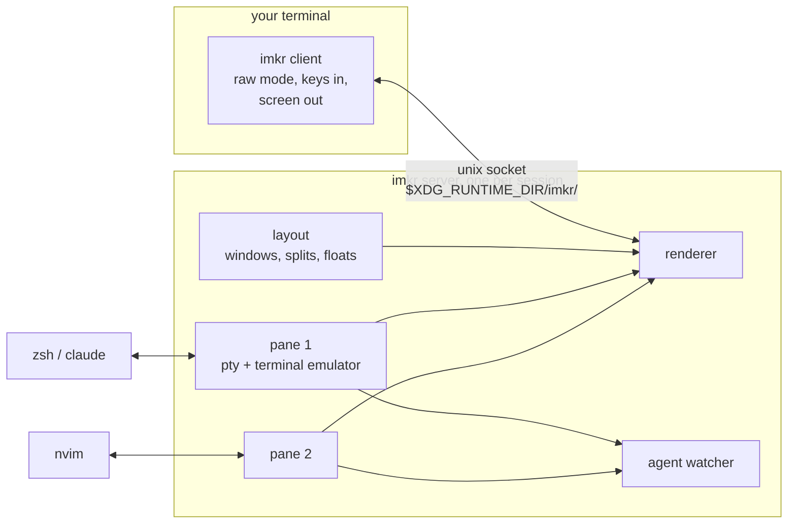
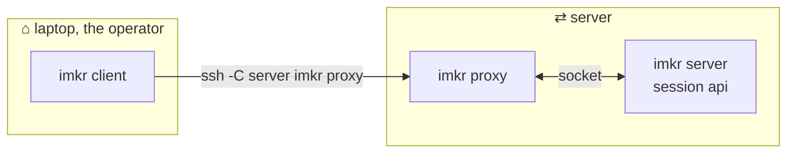
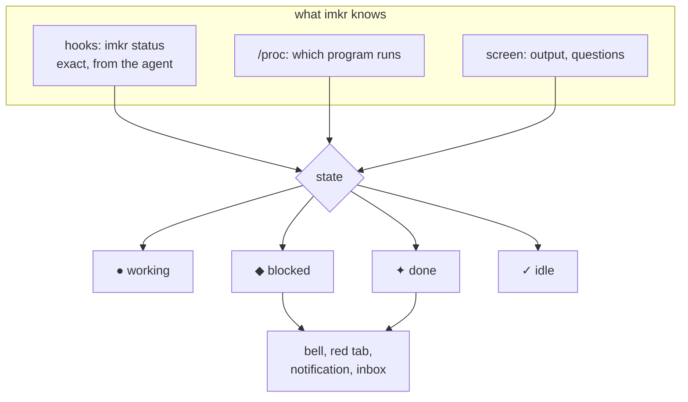
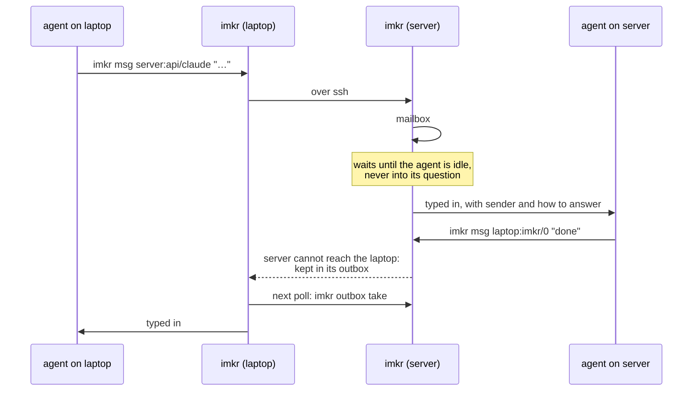
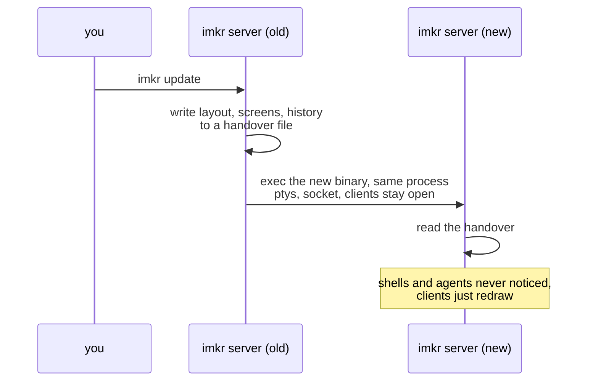
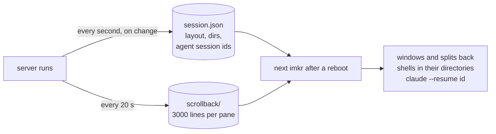
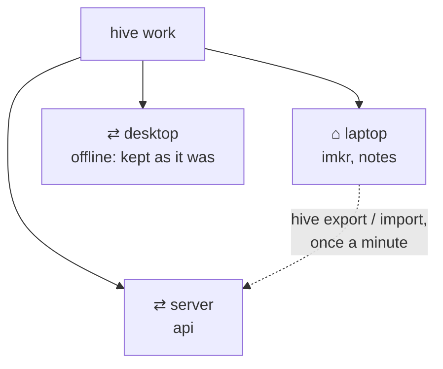

# How imkr works

A look under the hood: what runs where, and why things survive what they survive.

## Server and client

The first `imkr` starts a server in the background. The server owns every pty, parses what the
programs write (with `alacritty_terminal`), lays out the panes and draws the screen. The client
is thin: it sends key and mouse events and writes what the server drew to your terminal. Detach,
and only the client goes. Several clients can attach to one session, as in tmux.

Scripts and agents talk to the same socket: `imkr send`, `imkr read`, `imkr msg` and the MCP
server are requests over it, answered and done.

## Other machines

On another machine, the client stays where you sit: keys, clipboard, images and links are local.
ssh starts `imkr proxy` there, which passes the same protocol through. Every connection starts
from the machine you sit at, with your ssh keys: servers never need ssh back to your laptop.
Every 5 seconds imkr asks each known machine what runs there (`imkr ls --json`), which fills the
sidebar and the session list.

## Agent states

imkr reads the program from `/proc` and guesses from the screen. Hooks (`imkr hooks --install`)
report the exact state and win over guesses. Each tick (500 ms) imkr compares, rings on a new
`blocked`, and keeps the time a pane has been in its state.

## Messages between agents

When a machine is out of reach, the message waits in the sender's outbox for 24 hours, and the
machine it is for collects it the next time it asks. So answers find their way back without
every machine reaching every other.

## Updating without a restart

The server execs the new binary in its own process. The open file descriptors (every pane's
pty, the socket, every attached client) stay open across `exec`; everything else goes through a
file. `imkr hosts sync` does this on every machine.

## When the machine restarts

Processes cannot survive a reboot, but the layout can: imkr saves it while it runs. The next
`imkr` builds the windows again, starts shells in their old directories, puts each pane's
history above them and resumes the agents by their session ids. Ending a session on purpose
deletes the file and keeps the layout in the hive `last`.

## Hives

A hive is a saved map of sessions on every machine. Every machine keeps a copy and fetches newer
ones from the others, so `imkr hive restore work` works from any of them, and a new machine joins
by restoring one.
