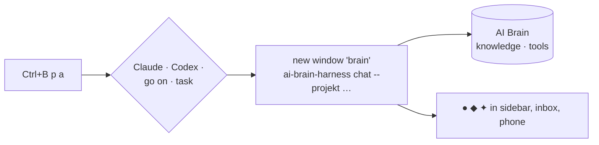
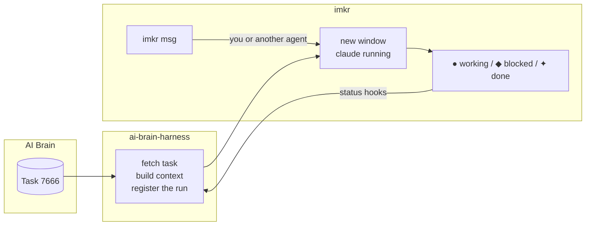
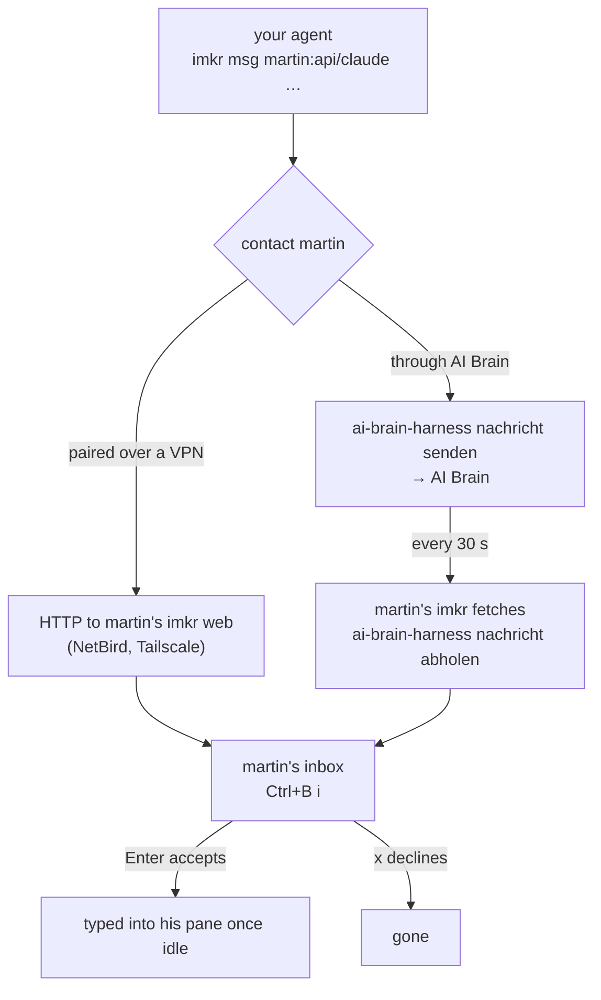
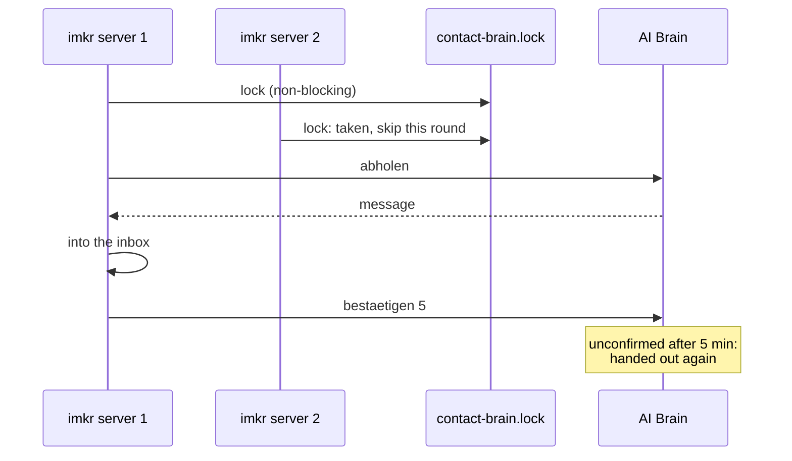
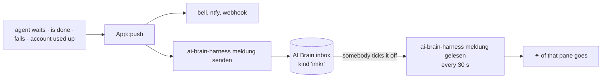

# imkr and AI Brain

[AI Brain](https://brain.proxy.peppermint-digital.com) keeps tasks, knowledge and people.
The AI Brain harness (command `ai-brain-harness`, called `ai-brain-cli` until October 2026;
the old name still works) is its program on each machine. imkr works with it in four ways, and needs it for none
of its own features:

- **`brain`, a conversation**: like Hermes, with Claude or Codex, the project's knowledge and AI
  Brain's tools, in an imkr window.
- **CLI mode**: an agent for an AI Brain task, in an imkr window, with AI Brain's context.
- **Messages to people**: colleagues' agents reach yours through AI Brain, without a shared
  network.
- **Events in the shared inbox**: what your agents do lands in AI Brain's inbox, and ticking a
  line off there clears its ✦ here.

Both need `ai-brain-harness` installed and connected:

```bash
curl -fsSL https://brain.proxy.peppermint-digital.com/install.sh | sh
ai-brain-harness connect
```

## brain: a conversation, like Hermes

`ai-brain-harness chat`, short `brain`, is the harness with an input line: it signs in to AI Brain,
brings the project's knowledge and AI Brain's tools, and then hands you Claude's or Codex' own
input line. imkr is where these conversations run: each in a window of its own, with its state in
the sidebar, its questions in the inbox and on the phone, several at once on every machine.



| From | How |
|---|---|
| imkr, plugin | `Ctrl+B p a`: Claude, Codex, the last conversation again, or a task |
| a shell | `brain`, or `ai-brain-harness chat --modell codex --projekt imkr` |

The project is the AI Brain slug in the `CLAUDE.md` of the focused pane's directory or one above
it. The conversation runs on where imkr runs, so `Ctrl+B p a` in a session on the server talks
there.

## CLI mode: an agent per task

`ai-brain-harness agent` fetches a task, writes what the agent needs to know (the task, the
project's knowledge, the rules) and starts Claude Code or Codex on it. With `--imkr` it does so
in a new imkr window instead of in your shell. The work is split on purpose:



`ai-brain-harness` owns context, task and sign-in; imkr owns the window, the state and the
messages. So the agent shows in the sidebar, the inbox and `Ctrl+B a` like any other.

### Starting a run

| From | How |
|---|---|
| imkr, plugin | `Ctrl+B p t` (or `Ctrl+B p a`, then *Pick a task*): the open tasks of the project in this directory to pick one, or an order in words |
| a shell | `ai-brain-harness agent --task 7666 --imkr` |
| a shell, without a task | `ai-brain-harness agent --projekt imkr "Write the changelog" --imkr` |
| AI Brain | it lays out orders for a machine: `ai-brain-harness auftraege`, then `auftrag N` |

`ai-brain-harness agents` lists the runs on this machine, `logs ID` shows what one wrote,
`stop ID` ends it.

The plugin comes from the catalog `peppermint-digital/imkr-plugins`:

```toml
# ~/.config/imkr/config.toml
plugin_catalogs = ["git@github.com:peppermint-digital/imkr-plugins.git"]
```

```bash
imkr plugin add ai-brain
```

It shows the runs in the sidebar (`2 working · 1 waiting`), `Ctrl+B p a` opens a conversation,
`Ctrl+B p t` starts an agent for a task, `Ctrl+B p l` lists the runs. The project is the AI Brain slug in the `CLAUDE.md` of the focused
pane's directory or one above it; its tasks come from `ai-brain-harness aufgaben`. With an older
`ai-brain-harness` without that command, it asks for a task number or an order instead.

## Messages to people

Colleagues with their own imkr can message your agents, and you theirs. Two ways carry them:



Through AI Brain:

```bash
imkr connect brain martin                         # both sides, each with the other's name
imkr msg martin:api/claude "Can you look at the login bug?"
```

Over a VPN, where both can reach each other:

```bash
imkr connect invite                                 # you: a code, ten minutes
imkr connect join http://100.97.1.2:4657/ ABCD-EFGH # they
```

Messages from a contact wait until accepted, in `Ctrl+B i` or `imkr connect inbox`.
`imkr connect trust martin` types them in right away. A contact sends text only: no screens, no
keys, no shell.

### Delivered once, even when two imkr servers fetch

AI Brain hands out each message **at least once**: a message fetched but not confirmed comes
back. Two safeguards keep it from arriving twice:



On each machine only one imkr server fetches at a time, and AI Brain does not hand out a
message again for five minutes after it was fetched. If a fetcher dies before confirming, the
message comes again after those five minutes.

## Events in the shared inbox

A bell passes, a push notification passes. With a harness connected, every event that would
ring — an agent waiting for an answer, one finishing, one giving up, an account running dry, a
contact's message — also goes into AI Brain's inbox under its own kind, `imkr`. It stays there
until somebody ticks it off, next to the tasks, changes and notifications from the other
systems.



**On top, never instead.** The bell, `[push]` and the inbox are three ways out of one event, and
they do not replace each other. They also do not share every rule: while you type in a session,
the phone stays quiet (`quiet` in `[push]`) because you are looking at it — the inbox gets the
line anyway. It is a list, not an interruption, and leaving out what happened while you worked
would leave out exactly the lines you go through afterwards. What both share is the damper
against flicker: the same pane reports the same kind at most every two minutes.

**Ticking off comes back.** imkr marks an agent that finished while nobody watched with ✦. Whoever
ticks that line off in the inbox has seen it, so every imkr asks its harness every 30 seconds what
was ticked off and clears the ✦ of the pane it belongs to. Delivery is at least once, the same as
for messages: a line comes again until imkr confirms it, because clearing the same ✦ twice costs
nothing and leaving it once does.

| | |
|---|---|
| Switch | `brain_inbox` in the config, or `Ctrl+B ,` → *imkr events in AI Brain's inbox*; on by default |
| Without a harness | nothing happens and nothing is run — not even the 30-second question |
| Kinds | `blocked`, `done`, `failed`, `account`, `message` |
| A line carries | machine, session, window and pane, the agent, what it works on, and for a question or an error the bottom of its screen |
| Housekeeping | AI Brain drops ticked-off and confirmed lines after 30 days; unread ones stay |

Each machine reports for its own agents, so the setting belongs in every machine's config
(`imkr hosts sync` takes it along). A test world (`IMKR_SOCKET` outside the runtime directory)
never reports, so a fake agent in a test cannot fill the real inbox.
