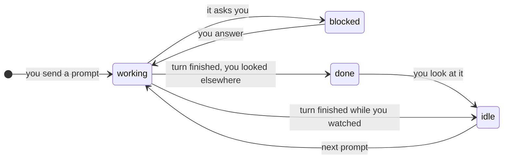

# Getting started

From nothing to agents on two machines, in five steps. Each takes a minute or two.


## 1. Install

```bash
curl -fsSL https://raw.githubusercontent.com/bastianhenneberg/imkr/main/install.sh | sh
imkr version
```

The binary lands in `~/.local/bin`. Linux on x86_64 or aarch64. See [install.md](install.md) for
other ways and for updating.

## 2. The first session

```bash
imkr
```

This starts a server in the background and attaches your terminal to it. The server owns the
shells: close the terminal, and they keep running. `imkr` again brings you back.

Press `Ctrl+B` and wait: a menu shows every key. A few to start with:

| Keys | What happens |
|---|---|
| `Ctrl+B` `%` | split side by side (`#` on a German keyboard) |
| `Ctrl+B` `"` | split top and bottom (`-`) |
| `Ctrl+B` `←↑↓→` | go to the pane there |
| `Ctrl+B` `n` | new window, asks for its name |
| `Ctrl+B` `1`–`9` | go to a window |
| `Ctrl+B` `f` `f` | float the pane above the others, and back |
| `Ctrl+B` `d` | detach: the terminal goes, the shells stay |

`Enter` after `Ctrl+B` lets you pick from the menu with the arrows, for when you forget a key.
All keys: [keys.md](keys.md).

Tab completion for `imkr …` in the shell, sessions and hosts included:
`eval "$(imkr completions zsh)"` in `~/.zshrc` ([more](install.md#tab-completion)).

## 3. Agents that report

Start Claude Code (or codex, opencode, aider, gemini, pi, …) in a pane. imkr marks the pane:



`● working`, `◆ blocked`, `✦ done`, `✓ idle`. Without help imkr guesses from the screen. For
exact states let Claude Code tell it:

```bash
imkr hooks --install    # once per machine you run agents on
imkr skill --install    # agents learn to message each other
```

Now `Ctrl+B a` jumps to the agent that has waited longest, and `Ctrl+B i` opens the inbox: every
waiting agent with its question, answered from there.

## 4. Another machine

ssh to it must work without a password (a key, an agent). Then:

```bash
imkr --host server
```

If imkr is missing there, it offers to install it. Your terminal now shows the session on
`server`; the sidebar lists both machines, and `Ctrl+B S` switches between all sessions on all
of them. Keep it for good:

```toml
# ~/.config/imkr/config.toml
hosts = ["server"]
```

Agents talk across machines too:

```bash
imkr agents --all
imkr msg server:api/claude "The API returns 409 on duplicates now."
```

More in [machines.md](machines.md) and [agents.md](agents.md).

## 5. On the phone

In a VPN such as Tailscale or NetBird:

```bash
imkr web          # prints the address and a pairing code
imkr web pair     # a QR code for the phone
```

Open the address on the phone, enter the code once, and you see every machine's agents, answer
them, and type into any pane. [phone.md](phone.md) has the firewall line and how to keep it
running.

## Where next

- Save everything that runs, on every machine, as a hive: `imkr hive save work`
  ([hives.md](hives.md)).
- Several Claude or Codex accounts with automatic fallback: `imkr account`
  ([agents.md](agents.md#several-accounts-and-the-next-one-when-one-is-used-up)).
- Plugins and your own commands in popups ([plugins.md](plugins.md),
  [settings.md](settings.md)).
- Agents for AI Brain tasks and messages to colleagues ([ai-brain.md](ai-brain.md)).
- How it all fits together ([architecture.md](architecture.md)).
